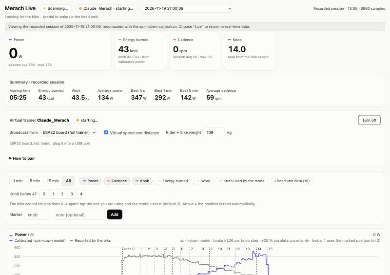
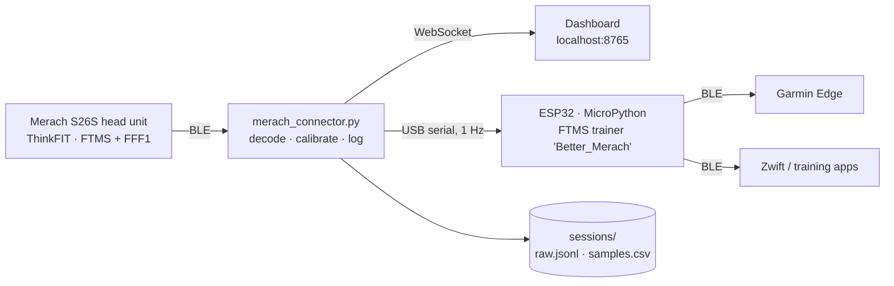
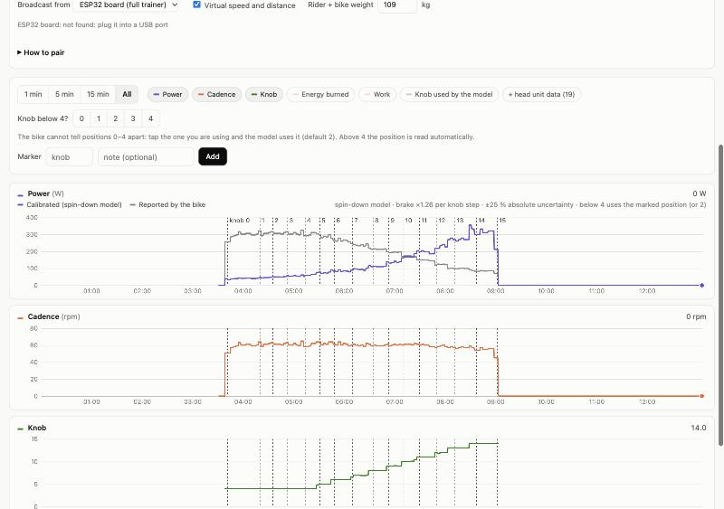

# Merach S26S — calibrated power meter & virtual smart trainer

[](LICENSE)


A Bluetooth LE toolkit for the **Merach S26S** magnetic exercise bike. It replaces the head unit's power figures,
which are wrong, with a **physically calibrated power model**, shows everything on a real-time dashboard, and
re-broadcasts the corrected data as a **standard smart trainer** that Garmin Edge, Zwift and similar apps can
pair with.



## Why

The S26S head unit (a ThinkFIT module) streams power, speed and calories over Bluetooth, but none of them can
be trusted:

| What the bike reports | What is actually happening |
|---|---|
| **Power** = a table value × cadence | The resistance-knob sensor is read **backwards**: turning the knob harder *lowers* the reported power (≈ 300 W at the lightest setting, ≈ 85 W at the hardest, both at 60 rpm). |
| **Resistance level** 1–8 | Inverted as well, and saturated over the first third of the knob travel. |
| **Speed / distance** | Cadence × 0.317 — independent of resistance. |
| **Calories** | 15 kcal per virtual km — independent of resistance. |

This project measures the bike's real braking behaviour with **spin-down tests** (no power meter needed) and uses
that model everywhere instead.

## Features

- **BLE connector** for the S26S: standard FTMS plus the reverse-engineered ThinkFIT vendor stream (`0xFFF1`).
  Every raw packet is logged.
- **Calibrated power**: a friction + eddy-current brake model fitted from coast-down data recorded by the bike's
  own crank revolution counter. Also derives the real knob position, work (kJ) and energy (kcal).
- **Real-time dashboard** (`http://localhost:8765`):
  - calibrated metrics first, with session summary and best 5 s / 1 min / 5 min power;
  - interactive charts and replay of any recorded session, recomputed with the current calibration;
  - the head unit's raw figures, kept apart for comparison.
- **Virtual smart trainer "Better_Merach"**:
  - re-broadcasts the calibrated data as an FTMS indoor bike, plus Cycling Power, in real time;
  - an **ESP32 board running MicroPython** advertises it byte-for-byte like the original bike, so Garmin devices
    list it as a trainer; the Mac's own Bluetooth can be used as a fallback.
- **Session logging**: `raw.jsonl`, `samples.csv`, GATT dump and advertisement scan for every ride.
- **Tools**: spin-down analysis and calibration export (`tools/spindown.py`), and a robust MicroPython REPL
  client (`tools/esp_repl.py`).

## How it works



1. The connector subscribes to every characteristic of the bike and decodes FTMS and ThinkFIT frames.
2. For each sample it reads the bike's internal *k* factor (W per rpm), maps it to the physical knob position, and
   computes power with the calibrated model: **P = I·(a + b₀·rᵏⁿᵒᵇ·ω)·ω**.
3. Results are logged, pushed to the dashboard over WebSocket and sent once per second to the virtual trainer.

Details: [protocol notes](docs/protocol.md) · [calibration method](docs/calibration.md) ·
[virtual trainer & ESP32 bridge](docs/virtual-trainer.md).

## Hardware

| Component | Notes |
|---|---|
| Merach S26S (MR-S26) | Magnetic resistance, manual knob, fixed 6 kg flywheel, belt drive 6:1. Other ThinkFIT/FTMS bikes may work with a new calibration. |
| Mac with Bluetooth LE | Tested on macOS with Python 3.9. The connector must run from Terminal (Bluetooth permission). |
| ESP32 dev board (optional, ~€8) | Any classic ESP32 or ESP32-S3/C3 with BLE (not the ESP32-S2). Needed for Garmin devices to see a full smart trainer. |

## Quick start

```bash
git clone https://github.com/lucacava/merach_device.git
cd merach_device
python3 -m venv .venv
.venv/bin/pip install -r requirements.txt
```

Start the connector: double-click **`run.command`** in Finder, or run it from Terminal:

```bash
open run.command
```

The dashboard opens at <http://localhost:8765>. Pedal a few strokes to wake the head unit, and close the Merach app
on your phone: the bike accepts a single Bluetooth connection.

> **Why Terminal?** macOS ties Bluetooth access to the app that launches the process. Terminal.app has the
> Bluetooth permission; some IDE or agent sandboxes do not and get killed by TCC on first use.

To work on the UI without the bike:

```bash
.venv/bin/python merach_connector.py --simulate --port 8766
```

## Usage

### Dashboard

- **Top row:**
  - **Power:** calibrated.
  - **Energy burned:** from the calibrated work.
  - **Cadence.**
  - **Knob:** read from the bike's sensor above position 4.
- **Knob below 4?** The bike cannot tell positions 0–4 apart. Tap the one you are using; otherwise the model
  assumes 2. The difference is about ±10 W at 60 rpm.
- **Summary:** moving time, energy, work, average power, best 5 s / 1 min / 5 min, average cadence.
- **Session selector** (header): replay any recorded session, recomputed with the current calibration.
- **Head unit data** and **Diagnostics** (collapsed): the bike's raw figures, raw packets with changed bytes
  highlighted, all decoded fields and the GATT tree.



### Virtual trainer

The **Virtual trainer** card controls the output:

| Setting | Values |
|---|---|
| Broadcast from | **ESP32 board** (default; full FTMS trainer), **Mac** (CoreBluetooth), or both |
| Virtual speed and distance | Speed on a flat road for the current power (Crr 0.004, CdA 0.32) |
| Rider + bike weight | Used by the virtual speed model (default 109 kg) |

**Pairing a Garmin Edge** (ESP32 output): Sensors → Add Sensor → Search All → **Better_Merach**. It appears as a
trainer and provides power, cadence, speed, distance and calories. **Zwift:** pick Better_Merach for Power and
Cadence. A Mac cannot see its own peripheral, so run Zwift on another device.

Setting up the ESP32 takes a few minutes: see [docs/virtual-trainer.md](docs/virtual-trainer.md).

### Command-line options

```text
merach_connector.py [--simulate] [--port 8765] [--address UUID | --name SUBSTRING]
                    [--no-calibration] [--k-max 5.03] [--k-min 1.527]
                    [--sensor] [--sensor-address UUID] [--sensor-name SUBSTRING]
                    [--no-control] [--scan-timeout 15] [--broadcast]
```

| Option | Purpose |
|---|---|
| `--simulate` | Fake bike data, no Bluetooth (the virtual trainer is disabled unless `--broadcast`). |
| `--address`, `--name` | Pin a specific bike when several are around. |
| `--no-calibration` | Ignore `calibration.json` and use the mirrored manufacturer table. |
| `--sensor` | Also connect an external Bluetooth cadence sensor (CSC) for per-revolution cadence. |
| `--no-control` | Never write to the bike's FTMS control point. |

### Re-calibrating

Spin the crank up at each knob position (0, 2, 4 … 14) and let it coast. Mark positions 0–4 in the dashboard.
Then run:

```bash
.venv/bin/python tools/spindown.py <session_id> --save
```

See [docs/calibration.md](docs/calibration.md) for the procedure and the model.

## Calibration results

Measured on one S26S with the method above (flywheel inertia 0.15 kg·m², 6:1 ratio):

| Knob | 40 rpm | 60 rpm | 90 rpm | Bike reports @ 60 rpm |
|---:|---:|---:|---:|---:|
| 0 | 24 W | 41 W | 71 W | ≈ 302 W |
| 4 | 33 W | 61 W | 118 W | ≈ 304 W |
| 8 | 56 W | 113 W | 234 W | ≈ 212 W |
| 10 | 78 W | 163 W | 346 W | ≈ 169 W |
| 12 | 114 W | 242 W | 524 W | ≈ 121 W |
| 14 | 169 W | 367 W | 805 W | ≈ 84 W |

The brake strengthens by **×1.26 per knob step**, the exponential signature of an eddy-current brake closing in
on the flywheel. Mechanical friction adds a constant 4.3 N·m at the crank.

## Project layout

```text
merach_connector.py        BLE connector, metrics pipeline, web/WebSocket server (entry point)
merach/
  parsers.py               FTMS / CPS / CSC / ThinkFIT decoders and the calibrated power model
  ble_sensor.py            virtual trainer: packet encoding and output management
  esp32_bridge.py          USB serial link to the ESP32 trainer
  gatt_peripheral.py       minimal CoreBluetooth GATT server (Mac output)
dashboard/index.html       single-file dashboard, no external dependencies
firmware/esp32/main.py     MicroPython FTMS trainer firmware
tools/spindown.py          spin-down analysis and calibration export
tools/esp_repl.py          MicroPython raw-REPL client (upload firmware, run code)
calibration.json           measured calibration used by the connector
docs/                      protocol notes, calibration method, virtual trainer guide
run.command                double-click launcher for macOS Terminal
```

Generated at runtime, not committed: `sessions/` (ride logs), `settings.json` (virtual trainer settings),
`.last_device`.

## Limitations

- **Absolute accuracy ≈ ±25 %.** The scale depends on the flywheel inertia, estimated from the declared 6 kg
  mass and a 38 cm diameter with rim-weighted mass. Relative changes, across knob positions and cadence, are
  measured, not assumed.
- **Knob 12–14 are partly extrapolated.** The flywheel stops within one or two revolutions there, and at 14 the
  brake starts touching the flywheel.
- **Knob 0–4 share one sensor reading:** mark the position in the dashboard for best accuracy.
- **No resistance control** (ERG, grade simulation): the knob is mechanical.
- **macOS only for the connector.** The Mac output cannot advertise FTMS service data, so Garmin devices need the
  ESP32 output to see a trainer.

## Disclaimer

This is an independent project, not affiliated with or endorsed by Merach or ThinkFIT. It is provided as is, for
personal use. Power estimates are not a substitute for a calibrated power meter. Exercise within your limits.

## License

[MIT](LICENSE) © 2026 lucacava
